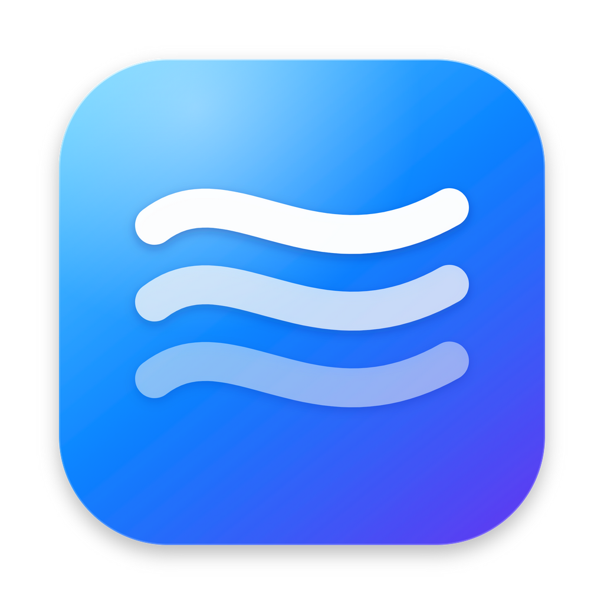
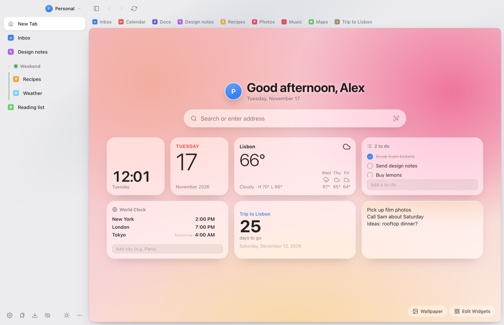
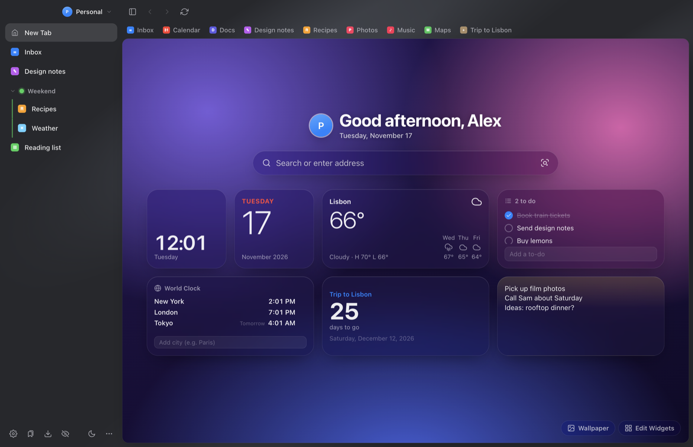
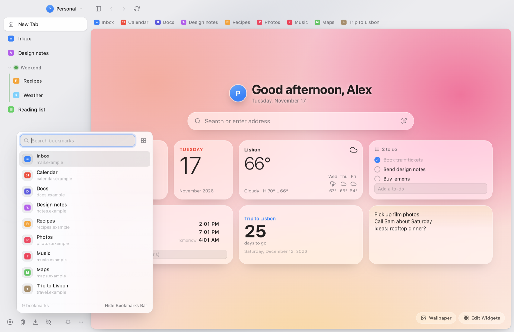
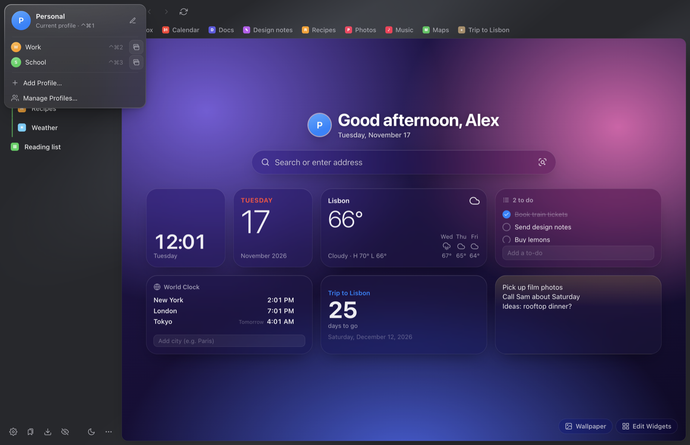
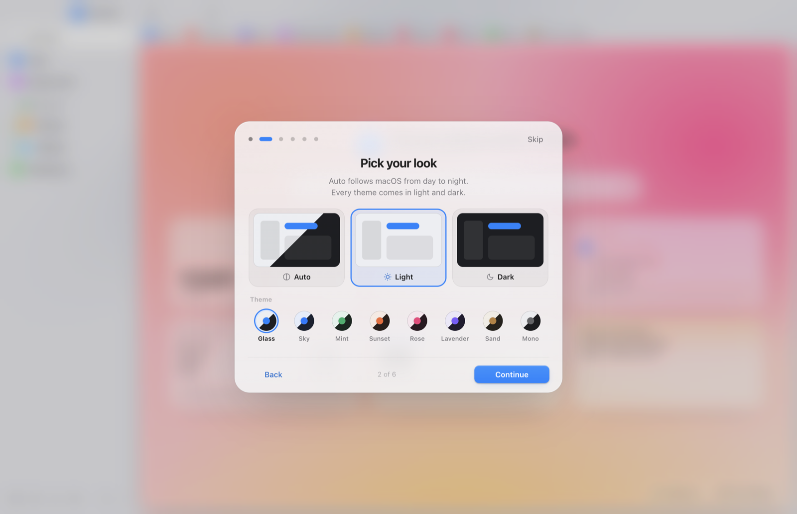

<p align="center">
  
</p>

<h1 align="center">Comet</h1>

<p align="center">
  A calm, glassy web browser for the Mac.<br>
  Vertical tabs, a Home screen with widgets, light and dark everything, profiles side by side.
</p>

<p align="center">
  <a href="https://github.com/ProffesorDiggamore/comet-browser/releases/latest/download/Comet-macOS-arm64.dmg"><b>⬇︎ Download Comet for Mac</b></a>
  &nbsp;·&nbsp; Apple silicon · macOS 13 or later
  &nbsp;·&nbsp; <a href="https://github.com/ProffesorDiggamore/comet-browser/releases">All releases</a>
  &nbsp;·&nbsp; <a href="LICENSE">MIT License</a>
</p>

<p align="center">
  
</p>

<table>
  <tr>
    <td></td>
    <td></td>
  </tr>
  <tr>
    <td></td>
    <td></td>
  </tr>
</table>

---

## Install

1. **Download** [Comet-macOS-arm64.dmg](https://github.com/ProffesorDiggamore/comet-browser/releases/latest/download/Comet-macOS-arm64.dmg) and open it.
2. **Drag Comet onto the Applications folder** in the window that appears.
3. **Open Comet** from Launchpad or Spotlight (⌘Space, type “Comet”).

**The first time you open it**, macOS may say it can't check Comet for malicious software. Comet isn't signed with a paid Apple Developer ID yet, so macOS asks you to confirm once:

- Click **Done** on that message.
- Open **System Settings → Privacy & Security**, scroll down, and click **Open Anyway** next to “Comet was blocked”.
- Confirm with your password or Touch ID. After this, Comet opens normally.

<details>
<summary>Prefer the Terminal?</summary>

```bash
xattr -dr com.apple.quarantine /Applications/Comet.app
```

This removes the “downloaded from the internet” flag so macOS stops asking.
</details>

**Updating:** download the new DMG and drag Comet onto Applications again, choosing **Replace**. Your tabs, bookmarks, passwords and settings live in `~/Library/Application Support/Comet` and are kept.

**Uninstalling:** drag Comet from Applications to the Trash. To remove your data too, delete `~/Library/Application Support/Comet`.

---

## Getting started

Comet opens with a short **Welcome tour**: pick light, dark or auto, a theme, sidebar or top tabs, your name and a wallpaper, then bring in bookmarks and passwords from another browser. You can replay it any time from **Help → Welcome Tour…**.

### The basics

| Do this | Shortcut |
|---|---|
| New tab | ⌘T |
| Type an address or search | ⌘L |
| Command palette: every command, tab and bookmark | ⌘K |
| Hide or show the sidebar | ⌘B |
| Reopen the tab you just closed | ⇧⌘T |
| Back / forward | ⌘[ / ⌘] or two-finger swipe |
| Jump to tab 1–8, or the last tab | ⌘1 … ⌘8, ⌘9 |
| Private tab (nothing saved) | ⇧⌘N |
| Find in page | ⌘F |
| Split two pages side by side | ⌘\ |
| See all your tabs at once | ⇧⌘\ |

The full list is in **Settings → Shortcuts**.

### Tabs

- **Vertical tabs** live in the sidebar. Drag a tab onto the tiles at the top to **pin** it.
- **Tab groups:** right-click a tab → **Add Tab to New Group** (⌥⌘G). Name it, pick a color, click it to fold it away. Drag tabs in and out.
- **Rename a tab:** double-click its title.
- **Peek:** ⇧-click any link to open it in a sheet over the page. Open it as a tab, split it beside the page, or press Esc to dismiss.
- **Now Playing:** when a tab plays sound, a mini player appears at the bottom of the sidebar. It can show Spotify too.
- Prefer tabs across the top? **Settings → Layout → Style → Top tabs.** The sidebar can also sit on the right.

### Bookmarks

- **⌘D** or the ☆ in the toolbar bookmarks the page.
- The **Bookmarks button** (bottom of the sidebar, or the toolbar with top tabs) opens a compact list of all your bookmarks with search. Press ⌥⌘B to open it from anywhere.
- **Rename** a bookmark: right-click it → **Rename…**, or double-click it in the list.
- Clicking a bookmark opens it in a new tab. ⌘-click opens it in the background and ⇧-click in Peek.
- **⇧⌘B** shows or hides the bookmarks bar under the toolbar.

### Profiles: keep accounts apart

Profiles are separate identities, each with its own tabs, bookmarks, history, saved passwords, cookies and logins, Home screen and look. Use them for Personal / School / Work, or to stay signed in to two accounts on the same site.

- **Switch** from the avatar at the top of the sidebar, or ⌃⌘1 … ⌃⌘9.
- **Open a profile in its own window** to use two at once: the avatar menu, **Profiles → Open in New Window**, Settings → Profiles, or right-click Comet in the Dock.
- Each window keeps its profile, and the windows that were open come back the next time you launch Comet.
- **Reorder** by dragging profiles in the avatar menu or Settings → Profiles; ⌃⌘1 … ⌃⌘9 follow that order.
- Manage them in **Settings → Profiles**: rename, color, emoji or photo, remove.

### Passwords

Comet offers to save a password when you sign in, and to **update** it when you change one. It doesn't offer to save a password the site rejected. Saved passwords fill in from the key icon in the field, and each profile keeps its own. They are encrypted with your Mac's keychain and never leave your Mac. Manage them in **Settings → Passwords**.

### Search that guesses

As you type in the Home search box or the address bar, Comet shows its best guess in gray: a site you visit, or your search engine's top prediction. Press → or Tab to take it, or keep typing. Predictions are never requested from private tabs or for things that look like addresses, emails or passwords; turn them off in **Settings → Search & Tabs**.

### Spotify

Add the **Spotify** widget to Home (Edit Widgets → Add Widget) to see what's playing and control it: play, skip, seek, shuffle, volume and search. It controls the Spotify app on your Mac, so there's no account to connect; macOS asks once to let Comet control Spotify. ⌘K → “Spotify” or `sp <song>` works too.

### Easy Files

When a site asks you to upload a file, Comet first offers what you just copied (a screenshot, an image, Finder files, or text) and your newest downloads. One click and the site receives it. **Browse files…** opens the regular dialog.

---

## Make it yours

Everything is in **Settings** (⌘,), and the search box at the top finds any option.

- **Appearance:** Auto / Light / Dark, eight themes that work in both modes, or a Custom theme with your own tint, glow and accent. Interface font (System, Rounded, Serif, Mono). Increase contrast. Liquid glass presets (Clear, Frosted, Solid) with fine-tuning sliders. Animated background styles.
- **Layout:** sidebar or top tabs, sidebar on the left or right, its width, comfortable or compact rows, the page card's corner radius and margin, and which buttons appear in the toolbar (right-click the toolbar → Customize Toolbar…).
- **Home Screen:** your name, a wallpaper (presets, any photo, or your desktop picture) with a dim slider, and Apple-style widgets: clock, world clock, calendar, weather, Spotify, to-do, notes, focus timer, countdown, batteries, top sites, clipboard, open tabs and more. Choose Edit Widgets to drag, resize and add widgets from a gallery with live previews. Pick a widget style (Full Color, Tinted, Clear, Frosted, Liquid, Solid), the widget size and where they sit.
- **Search & Tabs:** search engine and keywords, search suggestions, whether unused New Tabs close themselves, ⇧-click to Peek, Easy Files, and make Comet your default browser.
- **Privacy & Shield:** tracker blocking, HTTPS-only, Global Privacy Control, clearing browsing data.
- **Backup & Restore:** export all your settings to a file and import them on another Mac. Passwords and API keys are never included.

---

## Privacy

Comet is local-first. Your history, bookmarks, passwords and settings stay in `~/Library/Application Support/Comet` on your Mac. Built-in tracker blocking and HTTPS-only are on by default. Search suggestions send what you type in the search box to your search engine, like every browser does; switch them off in Settings → Search & Tabs. The optional Comet AI assistant (⌘J) runs on your Mac with [Ollama](https://ollama.com); it only talks to a cloud model if you add your own API key.

---

## Build from source

You need macOS, [Node.js](https://nodejs.org) 18 or later, and Git.

```bash
git clone https://github.com/ProffesorDiggamore/comet-browser.git
cd comet-browser
npm install
npm start
```

| Command | What it does |
|---|---|
| `npm start` | Run Comet from the source folder (shares data with the installed app) |
| `npm run install-app` | Build `Comet.app` and install it in /Applications |
| `npm run dist` | Build the drag-to-install disk image: `dist/Comet-macOS-arm64.dmg` (needs Python 3 the first time, for [dmgbuild](https://github.com/dmgbuild/dmgbuild)) |

Double-clicking `start.command` in Finder does the same as `npm start`.

### How it's put together

Comet is an [Electron](https://www.electronjs.org) app written in plain JavaScript with no bundler.

```
src/
├── main/        main process: windows, profiles, settings store, password vault,
│                tracker shield, downloads, menus, Comet AI (assistant/)
├── preload/     preload.js = the window.flux bridge; webview-preload.js runs in pages
└── renderer/    the interface: app.js boots it; components/, core/, styles/ (tokens,
                 glass, themes), data/ (themes, search engines)
scripts/         build-app.sh, install-app.sh, make-dmg.sh, icon + DMG background renderers
build/           app icon (icon.svg, AppIcon.icon for macOS 26), DMG background
```

The browser was called **Flux** before v0.8. A few internal names keep that on purpose, so existing logins, saved passwords and macOS permissions carry over: the keychain item “Flux Safe Storage”, the bundle id `com.whoslandon.flux`, `productName` in package.json, the `flux:` IPC channels and `window.flux`.

### Things that will bite you

- **Electron's installer and this folder name:** if the project path contains `&`, Electron's own extractor fails. `scripts/setup-electron.mjs` (run by `npm install`) works around it.
- **Building inside iCloud Drive:** iCloud re-adds Finder info mid-build and breaks code signing, so the build scripts stage the app in a temp folder.
- **Extensions:** Electron supports a useful subset of Chrome extensions; MV3 service-worker-only extensions may not fully work.
- **`<webview>`** renders pages. If Electron ever drops it, `renderer/core/tabs.js` would move to `WebContentsView`.

---

## What's new

See [CHANGELOG.md](CHANGELOG.md).

---

## License

Comet is open source under the [MIT License](LICENSE). You're free to use, change and share it.
